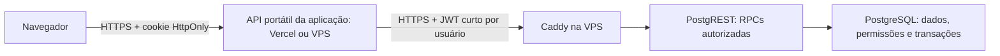

# Plano de persistência em PostgreSQL

Data: 26/10/2026. Status: primeiro incremento técnico implementado e validado localmente; infraestrutura de produção não alterada.

## Objetivo e decisões pendentes

Centralizar cadastros, configurações e escalas usando PostgreSQL, PostgREST, Caddy e RPCs na VPS. A Vercel permanece como hospedagem atual durante a transição; a arquitetura deve permitir hospedar frontend e API na VPS usando o domínio fintria.com.br, no momento oportuno. O endereço informado é `db.fintria.com.br`; A API PostgREST informada é `https://api.fintria.com.br/`; a versão instalada foi confirmada pelo operador como **14.15**, com imagem configurada como `latest`. O papel exato do endereço db.fintria.com.br na publicação ainda deve ser confirmado. A integração deve preservar os demais projetos da VPS.

Decisão confirmada: inicialmente, somente equipes dos escritórios terão acesso. O produto atenderá várias contabilidades independentes, cada uma com suas empresas. O escritório será a unidade principal de isolamento. Contas individuais, permissões por empresa, sessão máxima de 12 horas e migração gradual são as premissas propostas. O outro projeto usa webhooks de login e cadastro no n8n. As exportações foram analisadas estaticamente: são uma base reutilizável, com adaptações necessárias descritas em [Análise dos fluxos n8n](autenticacao-n8n.md). Não haverá página nem endpoint de autocadastro livre para este produto. Escritórios e usuários serão provisionados por administração autorizada; convites, se adotados, apenas ativam vínculos previamente autorizados. Identidades compartilhadas só devem ser reutilizadas quando fizerem parte do mesmo domínio de confiança; as permissões deste produto permanecem específicas.

## Arquitetura recomendada

O frontend usa `fetch('/api/...')`. A API valida a sessão, valida a operação e emite um JWT curto para a chamada à VPS, com `sub` do usuário, emissor, audiência, expiração e identificação da sessão. Sua validade não ultrapassa a sessão original. A assinatura deve ser compatível com a versão do PostgREST instalada. O navegador não recebe credenciais do banco nem a chave de assinatura. A API da aplicação oferece operações explícitas, não um proxy arbitrário para qualquer função SQL. Implementar a lógica de autenticação e persistência em módulos de servidor independentes da hospedagem: um adaptador atende à Vercel e outro ao servidor Node.js na VPS. O frontend conserva as mesmas URLs relativas `/api/...`.

Caddy termina HTTPS. PostgREST fica em endereço interno/loopback e PostgreSQL em rede privada, sem exposição pública da porta 5432 para esta integração. Durante a hospedagem na Vercel, o endpoint HTTPS de dados precisa ser alcançável por ela e validar credenciais em cada chamada. Depois da migração, a API da aplicação, o PostgREST e o PostgreSQL podem se comunicar em rede privada da VPS, com apenas a aplicação publicada pelo Caddy. Autenticação restringe o acesso; não torna um endpoint público invisível. Bloquear por IP só é opção se houver saída estável efetivamente disponível na hospedagem.

## Autenticação e autorização

O código atual (`server/auth.js`) usa senha compartilhada e cookie HMAC de 12 horas, sem identidade individual. Esse cookie não é um JWT do PostgREST. A evolução precisa associar sessão a usuário e permitir expiração, saída e revogação no servidor. Login e recuperação, se houver, são endpoints públicos específicos; as operações de dados exigem autenticação.

Reutilizar o emissor de identidade existente, se adequado; caso contrário, implementar contas individuais com senha armazenada por hash apropriado, proteção contra tentativas repetidas e sessões revogáveis. Manter cookie HttpOnly, Secure em HTTPS e SameSite, e proteção de origem/CSRF nas operações de escrita. APIs retornam JSON com 401/403, em vez do redirecionamento HTML hoje usado para páginas.

Cada RPC confere usuário ativo, sessão válida, vínculo com o escritório e acesso à empresa pertencente a esse escritório. Informar `empresa_id`, alterar o corpo da requisição ou possuir um JWT válido não concede acesso a outra empresa. Os papéis iniciais podem ser administrador do escritório, editor e consulta; a distribuição exata depende do público definido.

Isolar o produto em banco próprio, se os recursos da VPS permitirem, com credenciais e migrações próprias. Separar schema interno de dados e schema exposto de API. O PostgREST usa papéis sem superusuário e sem BYPASSRLS; não recebe credencial de proprietário. Revogar execução padrão de funções para PUBLIC, conceder apenas RPCs previstas e aplicar isolamento por empresa nas tabelas e nas funções. Preferir SECURITY INVOKER; qualquer SECURITY DEFINER precisa de proprietário restrito, search_path fixo e conferência explícita de autorização, pois pode contornar RLS conforme o proprietário.

## Isolamento entre escritórios

A estrutura é escritório → empresas → colaboradores, configurações e escalas. Um usuário recebe acesso por vínculo explícito com o escritório e, conforme seu papel, com empresas daquele escritório. O modelo pode suportar mais de um vínculo por usuário, sem conceder acesso implícito a outros escritórios. A seleção do escritório na interface apenas escolhe o contexto; a autorização é sempre conferida no servidor e no banco.

Todas as entidades de negócio têm pertencimento verificável a um escritório. Chaves estrangeiras compostas e restrições devem impedir associações cruzadas, como uma escala do escritório A apontando para um colaborador do escritório B. Políticas RLS e RPCs conferem o vínculo ativo, o escritório e a empresa. Auditoria, cache, filas e chaves de idempotência seguem esse mesmo escopo. Um mesmo CNPJ ou código Domínio cadastrado por contabilidades diferentes não une dados nem concede acesso cruzado.

Não haverá autocadastro público. O provisionamento é administrativo; eventual ativação por convite não permite escolher livremente um escritório existente nem conceder a si próprio papel de administrador. A entrada de membros usa convite autorizado. A criação autorizada de uma nova contabilidade estabelece um novo escritório e seu primeiro administrador de maneira transacional. A plataforma provisiona escritórios; o administrador de uma contabilidade só pode adicionar membros dentro dos limites do próprio escritório. Administração da plataforma, caso necessária, terá permissões separadas e explícitas.

## Avaliação da autenticação no n8n

A análise estática das exportações está documentada em [autenticacao-n8n.md](autenticacao-n8n.md). Antes de reutilizar em homologação, conferir: entrada e validação, identificação do usuário, hash de senha, assinatura e validação do JWT, expiração, renovação, revogação e tratamento de erros. Conferir algoritmo, emissor, audiência e finalidade dos tokens para evitar aceitar neste produto um token de outro sistema apenas porque foi assinado pela mesma chave. A emissão de tokens restritos para as RPCs poderá permanecer no n8n ou ocorrer na API portátil da aplicação, conforme o contrato verificado; o emissor definitivo ainda não foi escolhido.

O fluxo de login/cadastro é separado das consultas e gravações de escala, que seguem API da aplicação → PostgREST → PostgreSQL. Uma resposta positiva do webhook, isoladamente, não autentica a sessão: a aplicação precisa validar a credencial recebida e vincular o usuário às permissões persistidas. Nunca confiar em usuário, papel ou escritório enviados livremente no corpo da requisição. Logs de execução do n8n não devem reter senhas ou tokens; conferir esse ponto na integração.

Para a análise, usar exportação sem segredos, dados reais ou dados fixados de execuções (pinData). Exemplos de requisição/resposta e payload JWT, se fornecidos, devem ser fictícios e sem assinatura válida.

## Modelo inicial

| Entidade | Responsabilidade |
| --- | --- |
| Usuários e sessões | Identidade, estado da conta, validade e revogação; ou integração com emissor existente. |
| Escritórios e empresas | Organização do escritório, empresas atendidas e identificadores estáveis. |
| Vínculos de acesso | Usuários, escritórios, empresas, convites e permissões efetivas. |
| Colaboradores | Cadastro por empresa, cargo, habilitações, contrato de referência e dados importados. |
| Restrições | Ausências, indisponibilidades, folgas obrigatórias e janelas permitidas. |
| Configurações e cobertura | Jornadas, feriados, condições declaradas de ACT/CCT e faixas operacionais. |
| Cenários e versões de escala | Período, entradas, origem, proposta, edições, versão das regras e resultados preservados. |
| Importações | Origem, data, resumo e identificadores para evitar duplicação. |
| Auditoria | Autor, empresa, operação, entidade e revisão alterada. |

Usar colunas relacionais e chaves estrangeiras para identidade, empresa, vínculos e revisões. JSONB atende configurações variáveis e snapshots versionados. O cadastro corrente é a referência para novas simulações; uma versão histórica guarda suas próprias entradas imutáveis para não mudar quando o cadastro for editado. O banco atribui IDs globais; IDs locais e códigos da Domínio têm mapeamento e escopo por empresa, não são identidades globais.

Ausências podem conter informações sensíveis. Evitar armazenar justificativas médicas e planilhas originais sem necessidade; logs técnicos não devem registrar senhas, tokens ou o conteúdo integral dos cadastros. Definir retenção e acesso ao histórico junto com o uso real.

## Contrato de operações

Nomes ilustrativos de RPCs: `listar_empresas`, `obter_contexto_empresa`, `salvar_colaboradores`, `salvar_configuracao`, `confirmar_importacao`, `salvar_cenario`, `listar_versoes_escala`, `obter_versao_escala` e `arquivar_cenario`.

Todas validam tipos, tamanho, referências, pertencimento à empresa e permissão. Escritas compostas são transacionais. Usar `revisao_esperada` para concorrência otimista e `chave_idempotencia` para repetições de gravações/importações. Um conflito retorna a revisão atual e exige reconciliação; nunca sobrescrever silenciosamente o trabalho de outra pessoa. Paginar listagens e limitar tamanho de snapshots e tempo de execução.

RPCs cuidam de autorização, integridade e operações persistentes. Os cálculos de jornada continuam nos módulos JavaScript de domínio já testados, evitando reescrever o mesmo motor em SQL. Na primeira entrega, resultados calculados no navegador são salvos como rascunhos, com entradas e versão das regras. Isso não constitui aprovação da escala. Uma futura versão oficial deve ter validação autoritativa no backend, reutilizando o domínio JavaScript e conferindo edições manuais.

## Integração com a interface

Adicionar serviços JavaScript por domínio: sessão, empresas, colaboradores, configurações e escalas. A camada de interface não conhece URLs do PostgREST nem credenciais. Centralizar tratamento de 401, 403, conflitos, indisponibilidade e tentativas de gravação.

`assets/js/state/persistencia.js` hoje é síncrono e salva o estado inteiro em localStorage; vários chamadores dependem disso. Preservar inicialmente essa gravação local como rascunho e adicionar sincronização assíncrona controlada. Não substituir a função por uma Promise sem adaptar os chamadores. Identificar na interface: salvando, salvo no servidor, alterações locais pendentes, falha e conflito. Só indicar sucesso remoto após confirmação. Não fazer upload do estado completo a cada tecla.

Separar cache e fila por usuário/escritório/empresa/cenário. Saída e troca de conta bloqueiam o acesso ao cache anterior; uma fila antiga não pode ser enviada pela sessão de outro usuário. Em caso de expiração, preservar o rascunho de forma isolada, exigir login e reconciliar a revisão antes de enviar. Na primeira fase, não oferecer edição colaborativa em tempo real nem modo offline completo.

## Etapas de execução

1. **Inventário e contrato:** analisar os fluxos de autenticação n8n e definir o contrato de identidade para múltiplos escritórios; confirmar versões e serviços da VPS, roteamento do domínio, ambiente de homologação e política de backup. Produzir modelo, contratos e migrações revisáveis, sem modificar os serviços existentes.
2. **Base segura em homologação:** banco/schema, papéis, migrações, Caddy/PostgREST, autenticação, sessões e permissões. Entrega vertical mínima: usuário autenticado lista somente suas empresas e salva/reabre um rascunho; outro usuário não consegue acessá-lo.
3. **Persistência funcional:** serviços por domínio, seleção de empresa, cadastros, restrições, configurações, cobertura e cenários, com transações e revisões. Manter os cálculos e fluxos existentes.
4. **Migração assistida:** usuário escolhe a empresa, vê a prévia dos dados locais, confirma o envio e recebe os novos IDs. Preservar o original local até conferir a carga. Identificar dados de exemplo e evitar duplicação de colaboradores/importações. Não misturar automaticamente dados entre empresas.
5. **Versões e auditoria:** salvar origem/proposta, entradas e ajustes de cada versão; recuperar históricos e tratar conflitos entre abas/usuários. Separar versões das regras de cálculo e do formato dos dados para manter histórico mesmo após evolução do sistema.
6. **Migração de hospedagem:** após autenticação individual, isolamento e salvamento/recuperação estarem validados em homologação, preparar a VPS e escolher o endereço dentro de fintria.com.br sem afetar os serviços existentes. Validar a aplicação completa antes da troca de DNS; detalhes abaixo.
7. **Entrada em produção:** testar restauração de backup, acompanhar falhas e capacidade, executar migrações compatíveis e liberar primeiro para uma empresa piloto. Reversão da aplicação não apaga dados já gravados; alterações destrutivas no banco exigem migração própria.

## Hospedagem na VPS e momento da migração

A lógica de autenticação, sessão e serviços deve ser portátil desde o início. Não migrar apenas `dist/`: os arquivos estáticos não substituem a API, a proteção das páginas nem o middleware atual da Vercel. O servidor de desenvolvimento existente é referência para testes, não uma entrega pronta de produção.

Destino proposto: Caddy publica HTTPS e encaminha a um serviço Node.js da aplicação em rede privada; esse serviço protege páginas/recursos, atende `/api/*` e acessa PostgREST e n8n internamente. Serviços com usuários restritos, segredos fora do repositório, reinício supervisionado, limites de conexões, verificação de saúde e encerramento controlado fazem parte da entrega. Não depender de sessões apenas em memória de um processo. Configurar confiança nos cabeçalhos do proxy para cookies Secure e validação da origem, sem confiar em cabeçalhos encaminhados por clientes arbitrários.

O momento recomendado é depois da primeira entrega vertical homologada: login individual, dois escritórios isolados e rascunho salvo/recuperado. Nesse ponto, validar o adaptador VPS e executar o piloto antes de ampliar a migração dos dados. A saída da Vercel não depende de finalizar todos os relatórios ou funcionalidades do produto.

Escolher endereço no domínio fintria.com.br, por exemplo `escala.fintria.com.br`, sem presumir que a raiz está disponível. Preparar certificado, roteamento, volumes persistentes, backup e restauração; executar testes de login/expiração/revogação, arquivos e Web Workers, RPCs, impressão, importações e permissões no destino. Manter plano de retorno à hospedagem anterior sem duplicar gravações nem reverter dados silenciosamente. Quando necessário, usar janela curta de manutenção para a troca.

Mudança de origem exige novo login e não transfere localStorage automaticamente. Migrar rascunhos a partir da origem antiga ou oferecer exportação/importação assistida antes da troca, identificando usuário/escritório/empresa. Cookies devem ser exclusivos da aplicação e do host; evitar cookies genéricos em `.fintria.com.br` que interfiram em outros sistemas. DNS e serviços em produção só serão alterados na etapa de implantação definida.

## Critérios de aceite

- Sem sessão, JWT inválido/expirado ou sessão revogada: acesso negado no servidor, inclusive chamando diretamente as RPCs.
- Usuário de um escritório não acessa outro, inclusive em listagens, importações, versões e referências cruzadas. Cadastro e convites não permitem autoatribuição de privilégios.
- Usuário autenticado de uma empresa não lê nem altera outra, mesmo manipulando IDs; perfil de consulta não grava e usuário removido perde acesso.
- Não há segredo administrativo nos arquivos públicos; conexão sem credencial ao endpoint de dados não permite ler tabelas nem executar operações protegidas.
- Gravação composta inválida é revertida por inteiro. Repetição de importação não duplica registros; duas edições concorrentes geram conflito detectável.
- Dados são recuperados após login em outro navegador. Falha de rede não produz indicação falsa de salvamento; sessão de outra conta não sincroniza rascunhos anteriores.
- Migração mantém horários, intervalos, restrições, cobertura, contexto 44h da origem, proposta e edições manuais. Dados locais anteriores permanecem recuperáveis durante a migração.
- Testes de integração executam RPCs e políticas em PostgreSQL/PostgREST reais de homologação; regressões de domínio, interface e autenticação continuam aprovadas. Backup é validado por uma restauração, não apenas pela existência de um arquivo.

## Primeiro incremento entregue — 26/10/2026

Implementados [migração e provisionamento administrativo](../../database/README.md), isolamento RLS, RPCs de rascunhos, histórico/auditoria, revisão esperada e idempotência. Serviços portáteis de backend e cliente de frontend preparados e testados. Integração real executada em containers descartáveis com PostgreSQL 17 e PostgREST **14.15**, além dos testes unitários e build. O teste inclui estado fictício completo do simulador, sem dados dos arquivos de usuários.

Ainda não há rota pública de persistência montada nem adaptação do login individual: o handler nega acesso por padrão e não aceita o cookie de senha compartilhada como identidade. `PERSISTENCE_ENABLED` permanece false por padrão. Para ativar a entrega vertical na interface, a próxima etapa é integrar o contrato n8n, sessões individuais e seleção de empresa/rascunho. A referência histórica à versão 3.9 foi esclarecida pela informação de imagem `latest` e saída do binário 14.15. Nenhum token ou senha real foi solicitado para esta validação.

## Segundo incremento — login individual e rascunhos

Implementados: validação criptográfica do JWT de identidade n8n com emissor/audiência/expiração explícitos, mapeamento de subject, abertura/revogação de sessão no banco, limitação de tentativas, rotas HTTP portáteis, formulário de e-mail/senha opcional e painel de empresas/rascunhos. Cache e envios pendentes são separados por usuário e contexto, há importação local confirmada, repetição idempotente após resposta perdida e cópia local para revisar conflitos.

A implementação está testada com provedor simulado e serviços de banco reais; ainda depende da importação/configuração/homologação do novo fluxo n8n e da aplicação das migrações no ambiente escolhido. O login compartilhado não autoriza RPCs de dados. Guia e template: [integrations/n8n](../../integrations/n8n/README.md). Não houve modificação na VPS ou no n8n do usuário.
